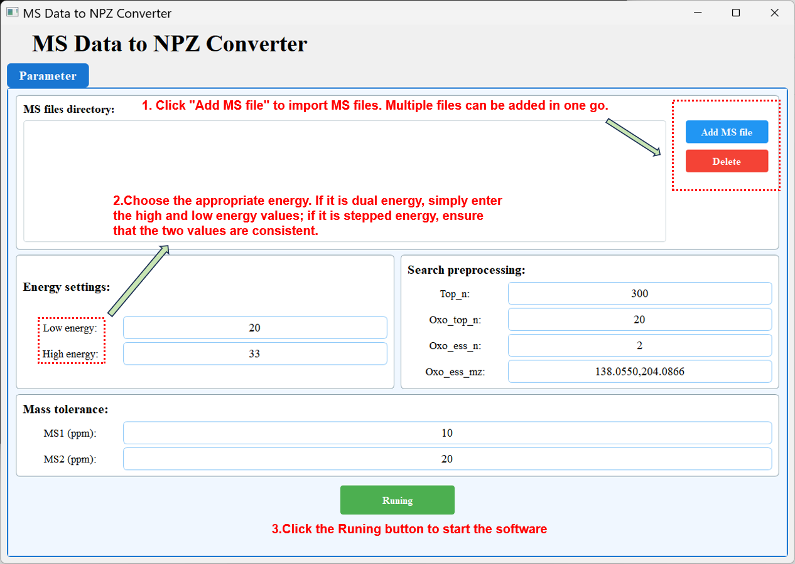

# MS Data to NPZ Converter

**MS Data to NPZ Converter** is a graphical tool for converting mass spectrometry data files into NPZ files for subsequent spectrum processing and analysis.

The software supports batch import of multiple MS files and allows users to configure collision energy, spectrum preprocessing parameters, and MS1/MS2 mass tolerances before conversion.




---

## Main Features

- Batch import of multiple MS data files
- Removal of incorrectly selected files
- Support for dual-energy and stepped-energy acquisition settings
- Configurable spectrum preprocessing parameters
- Independent MS1 and MS2 mass tolerance settings
- Batch conversion of selected MS files into NPZ format
- Simple graphical user interface

---

## Usage

### 1. Add MS Files

Click **Add MS file** to select MS data files.

Multiple files can be selected and added in a single operation. The selected files will be displayed in the **MS files directory** area.

To remove files:

1. Select one or more files from the file list.
2. Click **Delete**.

---

### 2. Configure Energy Settings

Enter the collision energy values used during MS data acquisition.

| Parameter | Description |
|---|---|
| **Low energy** | Collision energy used for low-energy spectra |
| **High energy** | Collision energy used for high-energy spectra |

#### Dual-energy data

For dual-energy acquisition, enter the corresponding low- and high-energy values.

Example:

```text
Low energy: 20
High energy: 33
```

#### Stepped-energy data

For stepped-energy acquisition, enter the same representative energy value in both fields.

Example:

```text
Low energy: 30
High energy: 30
```

The entered values should match the acquisition method used for the selected MS files.


---

## Mass Tolerance

The **Mass tolerance** section defines the mass error allowed during spectrum preprocessing.

| Parameter | Unit | Description |
|---|---:|---|
| **MS1** | ppm | Mass tolerance for precursor ions |
| **MS2** | ppm | Mass tolerance for fragment ions |

Example:

```text
MS1: 10 ppm
MS2: 20 ppm
```

The tolerance values should be selected according to the mass accuracy of the instrument.

---

## Starting the Conversion

After adding the MS files and checking all parameter settings:

1. Confirm that the selected files are correct.
2. Confirm that the low- and high-energy values match the acquisition method.
3. Check the spectrum preprocessing parameters.
4. Check the MS1 and MS2 mass tolerances.
5. Click **Running** to start the conversion.

The software will process the selected files using the specified parameters and generate the corresponding NPZ data files.

---

## Recommended Workflow

```text
Add MS files
      ↓
Check the imported file list
      ↓
Set low and high collision energies
      ↓
Configure spectrum preprocessing
      ↓
Set MS1 and MS2 tolerances
      ↓
Click Running
      ↓
Generate NPZ files
```

---

## Parameter Example

The following settings correspond to the example shown in the graphical interface:

```text
Energy settings
    Low energy:   20
    High energy:  33

Search preprocessing
    Top_n:        300
    Oxo_top_n:    20
    Oxo_ess_n:    2
    Oxo_ess_mz:   138.0550,204.0866

Mass tolerance
    MS1:          10 ppm
    MS2:          20 ppm
```

These values are examples only. Users should adjust them according to the acquisition method and instrument performance of their own datasets.

---

## Notes

- Multiple MS files can be converted in one batch.
- Use the same acquisition parameters for files processed together.
- Ensure that all numeric fields contain valid values before starting.
- The `Oxo_ess_mz` field accepts comma-separated m/z values.
- For stepped-energy data, the low- and high-energy fields should contain the same representative value.
- Do not close the software while the conversion is running.

---

## Troubleshooting

### No files are processed

Check that at least one MS file has been added to the file list.

### Invalid parameter warning

Confirm that:

- all energy values are numeric;
- `Top_n`, `Oxo_top_n`, and `Oxo_ess_n` are valid integers;
- `Oxo_ess_mz` contains comma-separated numeric values;
- MS1 and MS2 tolerances are valid positive numbers.

### Incorrect energy assignment

Verify whether the original data were acquired using:

- dual-energy acquisition; or
- stepped-energy acquisition.

Then enter the energy values accordingly.

### A wrong file was added

Select the file in the file list and click **Delete** before starting the conversion.

