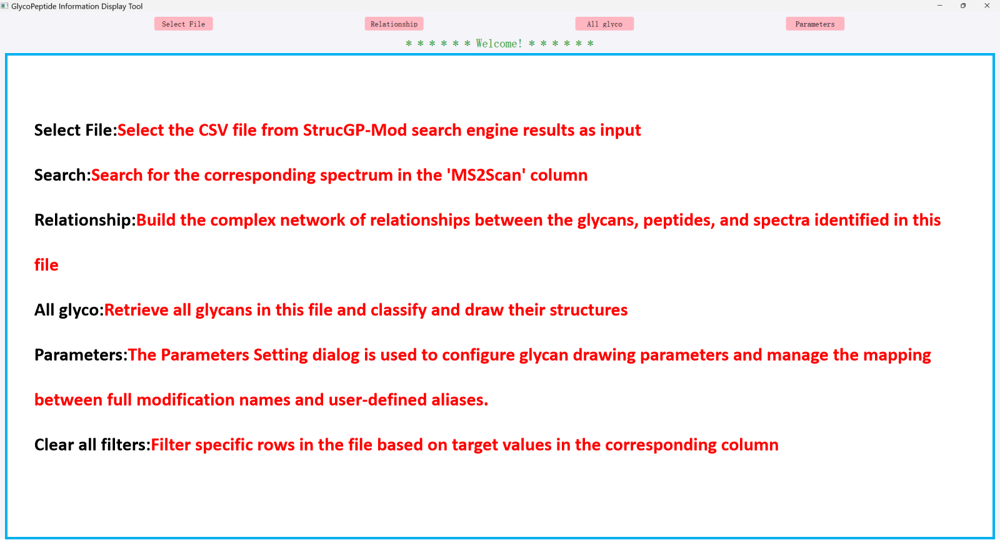
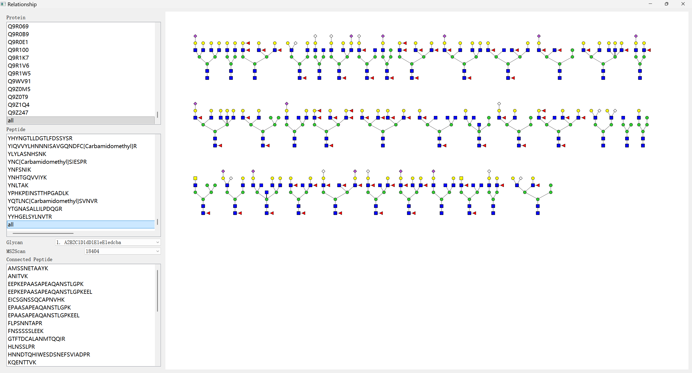
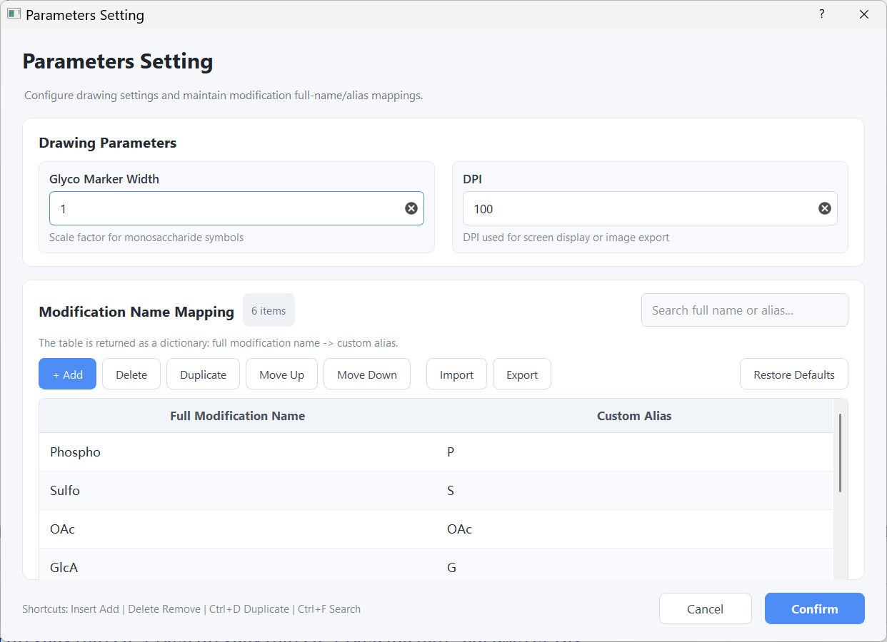

## Home

### Other page examples



### Parameters Setting

The **Parameters Setting** dialog is used to configure glycan drawing parameters and manage the mapping between full modification names and user-defined aliases.



> Replace `docs/images/parameters_setting.png` with the actual path of the screenshot in your repository.

### Opening the dialog

Click the **Parameters Setting** button in the main interface to open the dialog.

After editing the parameters:

- Click **Confirm** to validate, save, and apply the settings.
- Click **Cancel** to close the dialog without saving the current changes.

---

### Drawing Parameters

#### Glyco Marker Width

`Glyco Marker Width` controls the relative size of monosaccharide symbols in glycan structure plots.

| Value | Effect |
|---|---|
| `1.0` | Default symbol size |
| Greater than `1.0` | Enlarges monosaccharide symbols |
| Less than `1.0` | Reduces monosaccharide symbols |

The value must be a positive number.

#### DPI

`DPI` controls the rendering resolution used for screen display or image export.

| Suggested value | Usage |
|---|---|
| `78–100` | Normal screen display |
| Greater than `100` | Higher-resolution image rendering |

The value must be a positive integer.

---

### Modification Name Mapping

The **Modification Name Mapping** table defines how modification names are displayed in the software.

Each table row contains:

| Column | Description |
|---|---|
| **Full Modification Name** | The complete modification name used by the software |
| **Custom Alias** | A user-defined abbreviation used for display |

The table is internally stored as a Python dictionary:

```python
{
    "Full Modification Name": "Custom Alias"
}
```

The default mapping is:

```python
{
    "Phospho": "P",
    "Sulfo": "S",
    "OAc": "OAc",
    "GlcA": "G",
    "Fo": "F",
    "Fe": "Fe"
}
```

---

### Table Operations

#### Add

Click **+ Add** to insert a new empty row.

Enter the complete modification name in the first column and its custom alias in the second column.

Example:

| Full Modification Name | Custom Alias |
|------------------------|--------------|
| `Kdn`                  | `Kdn`        |

#### Delete

Select one or more rows and click **Delete** to remove them.

#### Duplicate

Select a row and click **Duplicate** to create a copy of the selected mapping.

The duplicated values can then be edited directly.

#### Move Up / Move Down

Use **Move Up** and **Move Down** to change the order of the selected entry.

#### Import

Click **Import** to load a modification mapping file.

Supported formats:

- JSON (`.json`)
- CSV (`.csv`)

Importing a file replaces the current table content with the imported mappings.

#### Export

Click **Export** to save the current modification mapping table.

Supported formats:

- JSON (`.json`)
- CSV (`.csv`)

#### Restore Defaults

Click **Restore Defaults** to replace the current table with the built-in default modification mappings.

Click **Confirm** afterward to save the restored settings.

---

### Search

The search box in the upper-right corner filters the modification table.

The search is performed against both:

- Full modification names
- Custom aliases

Clear the search box to display all entries again.

---

### Input Validation

Before the settings are saved, the software checks that:

- `Glyco Marker Width` is a valid positive number.
- `DPI` is a valid positive integer.
- Every row contains a full modification name.
- Every row contains a custom alias.
- Full modification names are not duplicated.
- Custom aliases are not duplicated.

When an invalid entry is detected, a warning message is displayed and the dialog remains open until the issue is corrected.

Completely empty rows are removed automatically when **Confirm** is clicked.

---

### Keyboard Shortcuts

| Shortcut | Action |
|---|---|
| `Insert` | Add a new row |
| `Delete` | Delete the selected row or rows |
| `Ctrl + D` | Duplicate the selected row |
| `Ctrl + F` | Focus the search box |

---

### Saving and Restoring Settings

After clicking **Confirm**, the software saves:

- Glyco Marker Width
- DPI
- Modification name mappings

The saved values are automatically restored the next time the **Parameters Setting** dialog is opened.

Clicking **Cancel** closes the dialog without saving the current changes.

---

### Example Workflow

To add a new modification alias:

1. Open **Parameters Setting**.
2. Click **+ Add**.
3. Enter the full modification name, for example `Acetyl`.
4. Enter its custom alias, for example `Ac`.
5. Click **Confirm**.

The resulting mapping will be:

```python
{
    "Kdn": "Kdn"
}
```